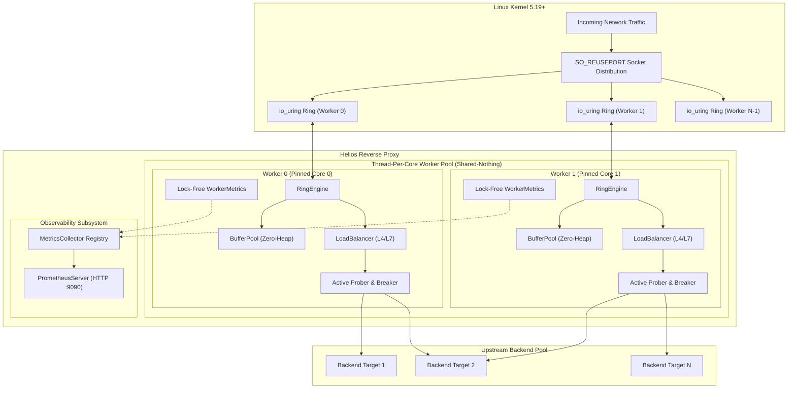

<div align="center">

# Helios

### Linux-Native `io_uring` Reverse Proxy & Load Balancer

[](https://github.com/losercreates/helios/actions/workflows/ci.yml)
[](https://en.cppreference.com/w/cpp/20)
[](https://kernel.org/)
[]()
[-brightgreen.svg)]()
[](https://prometheus.io)
[](LICENSE)

<p align="center">
  <b>Helios</b> is an ultra-high-throughput, Linux-native Layer 4/Layer 7 reverse proxy and load balancer implemented in modern <b>C++20</b> and built directly on the <b><code>io_uring</code></b> asynchronous kernel interface.
</p>

[Key Features](#-key-features) • [Architecture](#-architecture) • [Quickstart](#-quickstart) • [Configuration](#-configuration-reference) • [Comparative Benchmarks](#-comparative-benchmarking) • [Verification Matrix](#-verification--quality-gates)

</div>

---

## ⚡ Why Helios?

Traditional reverse proxies (like NGINX, HAProxy, and Envoy) rely on readiness-based event notifications (`epoll(7)` / `kqueue(2)`). While effective, `epoll` requires multiple user-kernel boundary transitions (`epoll_wait` → `read` → `write` → `epoll_ctl`) for every buffered network packet, leading to severe system call overhead and cache thrashing under 100K+ concurrent connections.

**Helios bypasses the readiness event-loop model entirely.** Built directly on Linux `io_uring`, Helios submits asynchronous batch I/O operations directly to kernel submission rings (`SQ`) and reaps completed operations from completion rings (`CQ`) with zero intermediate system calls:

* **Zero System Call Hot Path**: Submit and reap hundreds of network reads, writes, and accepts in a single syscall tick via shared kernel rings.
* **Zero-Allocation Data Path**: Memory allocations on the packet forwarding path are eliminated via pre-allocated, fixed-capacity buffer pools.
* **Shared-Nothing Thread-Per-Core**: Worker threads are pinned to dedicated physical CPU cores with private memory arenas, private rings, and private listener sockets distributed via kernel `SO_REUSEPORT`.
* **Zero Lock Contention**: No hot-path cross-thread mutexes, condition variables, or shared atomics on connection forwarding.

---

## 🏛 Architecture

Helios implements a strict **shared-nothing, thread-per-core** concurrency model. Incoming client connections are distributed by the Linux kernel directly across worker sockets via `SO_REUSEPORT`. Each worker processes its own connections independently using a private `RingEngine` and `BufferPool`.



---

## 🚀 Key Features

### 1. High-Performance Kernel Engine
* **Direct `liburing` Engine**: Direct integration with Linux kernel 5.19+ `io_uring` without generic event-loop abstraction layers (Boost.Asio / libuv).
* **Deterministic Operation Tracking (`OpContext`)**: Reference-counted context tagging in `SQE.user_data` guarantees resources and memory buffers stay pinned until kernel CQE completion events are reaped.
* **Fixed-Capacity `BufferPool`**: Pre-allocated memory blocks (default 16 KB) managed by a zero-lock LIFO free-stack.
* **High/Low Watermark Backpressure**: Automatically halts downstream socket reads and multishot accepts at 100% pool saturation, gracefully resuming reads once buffer availability drops below 80%.

### 2. Advanced Load Balancing Algorithms
Helios supports 4 pluggable, deterministic backend distribution strategies:
* **Round-Robin**: Uniform cyclic scheduling across healthy targets.
* **Smooth Weighted Round-Robin**: Interleaved NGINX-style scheduling preventing bursty clustering on high-weight backends.
* **Least-Connections**: Dynamic traffic routing directing requests to backends with the lowest active connection load.
* **Consistent Hashing**: Ketama-style virtual node hashing (64-bit ring) minimizing cache invalidation across topology changes.

### 3. Fault Resilience & Health Management
* **Asynchronous Active Prober**: Background `io_uring` TCP health checker with configurable check intervals, probe timeouts, and flapping hysteresis.
* **3-State Circuit Breaker**: Per-backend state machine (`CLOSED` → `OPEN` → `HALF_OPEN`) containing faults with cooldown timers and half-open probe quotas.
* **Zero-Drop Connection Draining**: Seamlessly drains in-flight client traffic (`SetDraining(true)`) while redirecting new traffic away without closing active streams.
* **Timeout-Bounded Half-Close**: Automatic `shutdown(SHUT_WR)` handling with a 5-second kernel fallback timer preventing resource leaks from dangling half-closed TCP sockets.

### 4. L7 HTTP/1.1 & Protocol Security
* **Zero-Copy Streaming Parser**: Streaming HTTP/1.1 parser operating directly on pinned buffer slices without dynamic memory allocation.
* **RFC 9112 Request Smuggling Prevention**: Strict validation rejecting ambiguous requests containing conflicting `Transfer-Encoding` and `Content-Length` headers, invalid chunk sizes, or malformed chunk delimiters.
* **HTTP Keep-Alive Connection Pooling**: Thread-isolated backend connection pooling reusing warm upstream sockets across consecutive client requests.

### 5. Telemetry & Production Operations
* **Prometheus `/metrics` Exposition**: Native HTTP/1.1 endpoint exposing real-time operational telemetry adhering strictly to Prometheus 0.0.4 plaintext exposition format.
* **Core Metrics Schema**: Exports request counters, throughput bytes, active connections, latency histograms (`50µs`, `100µs`, `300µs`, `+Inf`), `io_uring` ring statistics, buffer pool utilization, and backpressure pause counts.
* **Declarative Dynamic YAML Configuration**: Zero-dependency recursive-descent YAML parser validating configurations at startup with line/column diagnostic messages.
* **Production CLI**: CLI interface with `--config`, `--daemon`, `--test-config`, `--help`, and `--version` options.

---

## 🛠 Quickstart

### 🐳 Instant Docker Sandbox (Recommended)

Run a complete multi-container demonstration environment featuring **Helios**, two isolated upstream HTTP backends, a **Prometheus** scraper, and a pre-configured **Grafana** telemetry dashboard in seconds:

```bash
# Clone the repository
git clone https://github.com/losercreates/helios.git
cd helios

# Start the full demonstration stack (Helios + 2 Backends + Prometheus + Grafana)
docker compose up -d

# Verify load-balanced traffic (alternates round-robin between backend1 & backend2)
curl http://localhost:8080

# View real-time asynchronous access logs (JSON structured format)
docker compose logs -f helios

# Query Helios live Prometheus telemetry
curl http://localhost:9090/metrics
curl http://localhost:9090/healthz

# Access Pre-Configured Grafana Telemetry Dashboard
# Open http://localhost:3000 in your browser (Instant anonymous access, zero login required)
# Features live RPS throughput, latency heatmaps, io_uring SQE/CQE rates, and buffer pool gauges

# Access Prometheus Web UI
# Open http://localhost:9091 in your browser

# Tear down the stack
docker compose down
```

> [!NOTE]
> Since Helios leverages native Linux `io_uring` ring queues, container runtimes require unconfined seccomp profiles (`security_opt: [seccomp:unconfined]`) and unlimited locked memory (`ulimits: memlock: -1`). These are pre-configured in [docker-compose.yml](file:///home/mayukh/projects/helios/docker-compose.yml).

---

### 📦 Build Docker Container Image

Build a minimal (~33 MB), hardened multi-stage production container image with an unprivileged system user and `cap_net_bind_service` capabilities:

```bash
# Build production Docker image
docker build -t helios:latest .

# Run with custom configuration
docker run --rm -it \
  --security-opt seccomp=unconfined \
  --ulimit memlock=-1:-1 \
  -p 8080:8080 -p 9090:9090 \
  -v $(pwd)/config/docker_demo.yaml:/etc/helios/helios.yaml:ro \
  helios:latest -c /etc/helios/helios.yaml --daemon
```

---

### ⚙️ Build from Source (Linux / WSL2)

#### Prerequisites

Helios requires a Linux environment with kernel 5.19+ and a modern C++20 toolchain:

```bash
sudo apt update && sudo apt install -y \
  build-essential \
  cmake \
  ninja-build \
  g++ \
  clang \
  liburing-dev
```

#### Compile in Release Mode

```bash
# Configure and compile in Release mode
cmake -B build-release -DCMAKE_BUILD_TYPE=Release -G Ninja
cmake --build build-release -j$(nproc)
```

#### Validate Configuration

Before launching Helios, validate your YAML configuration syntax and semantic constraints:

```bash
./build-release/bin/helios -t -c config/helios_production.yaml
# Output: [HELIOS] Configuration file syntax and schema validation successful.
```

#### Run Helios

```bash
# Start Helios in daemon mode with production configuration
./build-release/bin/helios -c config/helios_production.yaml --daemon
```

#### 🔄 Zero-Downtime Configuration Hot-Reload

Update backend endpoints, topology, or weights on the fly without restarting Helios or dropping in-flight client connections:

```bash
# 1. Edit configuration file (e.g., config/helios_production.yaml)
# 2. Trigger hot reload via SIGHUP
kill -HUP $(pgrep helios)

# Or when deployed via systemd:
sudo systemctl reload helios

# Or within Docker Compose:
docker kill -s HUP helios-proxy
```
Helios re-validates the YAML file, reconciles backends across all pinned worker event loops, gracefully drains removed endpoints, and updates routing with zero downtime.

#### Query Live Telemetry

```bash
# Query Prometheus metrics
curl -i http://localhost:9090/metrics

# Query healthz endpoint
curl -i http://localhost:9090/healthz
```

#### 📝 High-Performance Asynchronous Access Logging

Helios features an asynchronous, lock-free non-blocking access logger. Worker event loop threads push lightweight entries without blocking on disk I/O; a dedicated background thread batches, formats, and flushes log entries to `stdout`, `stderr`, or a file:

```yaml
logging:
  enabled: true
  format: "json"                       # "json" (structured) or "combined" (Apache/Nginx format)
  output: "/var/log/helios/access.log" # "stdout", "stderr", or absolute file path
  queue_capacity: 131072               # In-memory non-blocking ring queue capacity
  flush_interval_ms: 100               # Background batched flush interval
```

Structured JSON log sample:
```json
{"time":"2026-10-17T04:10:00.123Z","client":"127.0.0.1:48290","method":"GET","uri":"/api/v1/resource","version":"HTTP/1.1","status":200,"bytes_sent":2048,"bytes_received":142,"duration_us":850,"upstream":"10.0.1.10:8080"}
```

---

### 🛡️ Production `systemd` Service Deployment

For bare-metal and VM production environments, deploy Helios as a hardened system service using the provided systemd unit:

```bash
# 1. Install binary and configuration
sudo cp build-release/bin/helios /usr/local/bin/
sudo mkdir -p /etc/helios
sudo cp config/helios_production.yaml /etc/helios/helios.yaml

# 2. Create unprivileged helios system user
sudo useradd -r -s /usr/sbin/nologin -d /var/empty helios

# 3. Grant low port binding capability (<1024)
sudo setcap 'cap_net_bind_service=+ep' /usr/local/bin/helios

# 4. Install and start systemd service
sudo cp packaging/systemd/helios.service /etc/systemd/system/
sudo systemctl daemon-reload
sudo systemctl enable --now helios

# Check service status and operational journal
systemctl status helios
journalctl -u helios -f
```

---

## 📋 Configuration Reference

Helios uses declarative YAML configuration files. Below is an annotated reference ([config/helios_production.yaml](file:///home/mayukh/projects/helios/config/helios_production.yaml)):

```yaml
# Helios Production Configuration
version: "1.0"

server:
  host: "0.0.0.0"                 # Listening IP interface
  port: 443                       # Listening TCP port (1-65535)
  workers: 0                      # Worker concurrency (0 = auto-detect hardware CPU cores)
  cpu_affinity: true             # Pin each worker thread to a dedicated physical CPU core
  max_connections: 50000          # Connection table capacity limit
  buffer_pool_blocks: 8192       # Fixed-capacity memory pool buffer blocks per worker
  buffer_block_size: 16384        # Byte capacity per buffer block (default 16 KB)
  io_uring_entries: 512          # io_uring SQ/CQ ring depth per worker (power of 2)

backend_pools:
  - name: "web_backends"          # Unique identifier for the backend pool
    algorithm: "weighted_round_robin" # round_robin | weighted_round_robin | least_connections | consistent_hash
    endpoints:
      - host: "10.0.1.10"
        port: 8080
        weight: 3
      - host: "10.0.1.11"
        port: 8080
        weight: 2

timeouts:
  idle_timeout_ms: 60000          # Inactivity timeout before closing idle connections
  header_read_timeout_ms: 5000    # Slowloris defense timeout for HTTP header parsing
  connect_timeout_ms: 2000        # Timeout for establishing upstream backend TCP connections
  half_close_fallback_ms: 5000    # Fallback timer for half-closed connections before force close
  drain_timeout_ms: 15000         # Maximum time allowed for active connections to drain upon shutdown

health_check:
  enabled: true                   # Enable asynchronous io_uring active probing
  interval_ms: 5000               # Frequency between consecutive health probes
  timeout_ms: 1000                # Connect probe timeout before failure
  unhealthy_threshold: 3          # Consecutive failures required to transition to Unhealthy
  healthy_threshold: 2            # Consecutive successes required to recover to Healthy

metrics:
  enabled: true                   # Expose Prometheus HTTP telemetry endpoint
  port: 9090                      # Telemetry server listening port
  path: "/metrics"                # Telemetry scraping endpoint path
```

---

## 📊 Comparative Benchmarking

Helios includes a comparative Google Benchmark test harness ([tests/benchmarks/bench_proxy.cpp](file:///home/mayukh/projects/helios/tests/benchmarks/bench_proxy.cpp)) directly comparing `helios::L4ProxyServer` (`io_uring`) against a 1:1 identical Linux baseline proxy `helios::EpollBaselineProxy` (`epoll(7)`):

```bash
# Build and run the comparative benchmark suite
./build-release/bin/helios_benchmarks --benchmark_filter=".*Proxy.*"
```

### Benchmark Scenarios Tested
1. **Throughput Scaling**: 1 KB, 4 KB, 16 KB, and 64 KB payload tiers evaluating kernel ring batching efficiency.
2. **Concurrency Sweep**: 1, 4, 16, and 64 concurrent client connections evaluating event scalability.
3. **Turnaround Latency**: Ping-pong request-response turnaround latency comparing ring completion latency against `epoll_wait` wakeups.

---

## 🛡 Verification & Quality Gates

Helios enforces strict quality gates across automated test suites, memory sanitizers, and thread sanitizers:

| Test Category | Suite Count | Test Count | Pass Rate | Key Verification Focus |
| :--- | :---: | :---: | :---: | :---: |
| **Unit Tests** | 16 Suites | **171 Tests** | **100%** | Ring engine, buffer pool, load balancers, health state, circuit breaker, HTTP parser, YAML loader, Prometheus exporter. |
| **Integration Tests** | 10 Suites | **64 Tests** | **100%** | Real kernel `io_uring` submissions, live TCP forwarding, backend failure injection, active probing, worker CPU affinity. |
| **E2E & Stress Tests** | 6 Suites | **6 Tests** | **100%** | End-to-end MD5 data integrity, buffer pool saturation backpressure, multi-connection storm stress testing. |
| **Total CTest Suite** | **32 Suites** | **241 Tests** | **100%** | **241/241 Passing in ~11.9s** |

### Sanitizer Verification Cleanliness

```bash
# AddressSanitizer & UndefinedBehaviorSanitizer (0 memory leaks, 0 undefined behavior)
cmake -B build-asan -DHELIOS_ENABLE_ASAN=ON -DHELIOS_ENABLE_UBSan=ON
ctest --test-dir build-asan --output-on-failure

# ThreadSanitizer (0 data races)
setarch x86_64 --addr-no-randomize ctest --test-dir build-tsan --output-on-failure
```

---

## 📁 Repository Structure

```text
helios/
├── CMakeLists.txt              # Root build configuration and dependencies
├── README.md                   # Project documentation & architecture overview
├── config/                     # Declarative YAML presets (helios_mvp.yaml, helios_production.yaml)
├── specs/                      # Engineering contracts, data models, and specifications
├── src/                        # Core source code
│   ├── main.cpp                # CLI entry point and multi-worker orchestrator
│   ├── worker.hpp/.cpp         # Thread-per-core pinned Worker and WorkerPool
│   ├── foundation.hpp/.cpp     # System metadata and C++20 foundation primitives
│   ├── buffer/                 # Fixed-capacity BufferPool & watermark backpressure
│   │   ├── buffer.hpp          # Buffer descriptor with ref counts and offsets
│   │   ├── buffer_pool.hpp/.cpp# Zero-heap allocation BufferPool allocator
│   │   └── backpressure_controller.hpp # High/low watermark backpressure controller
│   ├── io/                     # Linux io_uring RingEngine & OpContext tracking
│   │   ├── op_context.hpp      # Asynchronous operation lifecycle state model
│   │   └── ring_engine.hpp/.cpp# liburing SQE submission & CQE reaping engine
│   ├── backend/                # Upstream backend connection management
│   │   └── backend_pool.hpp/.cpp# Thread-isolated HTTP keep-alive connection pool
│   ├── lb/                     # Load balancing algorithms & health management
│   │   ├── backend.hpp/.cpp    # Generic backend entity and selection precedence
│   │   ├── health_checker.hpp/.cpp # Asynchronous io_uring active TCP probe engine
│   │   ├── circuit_breaker.hpp/.cpp# 3-state Circuit Breaker (Closed, Open, HalfOpen)
│   │   ├── load_balancer.hpp   # Polymorphic LoadBalancer interface
│   │   ├── round_robin.hpp/.cpp# Round-Robin algorithm
│   │   ├── weighted_round_robin.hpp/.cpp# Smooth Weighted Round-Robin algorithm
│   │   ├── least_connections.hpp/.cpp# Least-Connections algorithm
│   │   └── consistent_hash.hpp/.cpp# Ketama Consistent Hashing algorithm
│   ├── config/                 # Declarative YAML configuration loader
│   │   └── config_loader.hpp/.cpp# Zero-dependency recursive-descent YAML parser
│   ├── http/                   # L7 HTTP/1.1 protocol parsing & security validation
│   │   └── http_parser.hpp/.cpp# Zero-copy streaming HTTP parser & smuggling validator
│   ├── metrics/                # Lock-free telemetry & Prometheus HTTP exposition
│   │   ├── metrics_collector.hpp/.cpp# Thread-isolated lock-free metrics registry
│   │   └── prometheus_server.hpp/.cpp# Standalone HTTP telemetry server (:9090/metrics)
│   └── net/                    # Linux non-blocking TCP networking primitives
│       ├── socket_utils.hpp/.cpp# Non-blocking socket utilities
│       ├── listener.hpp/.cpp   # Multi-socket listener configuration (SO_REUSEPORT)
│       ├── tcp_listener.hpp/.cpp# io_uring TCP listener & async accept
│       ├── tcp_connection.hpp/.cpp# io_uring TCP connection, async R/W & half-close
│       ├── connection_pair.hpp/.cpp# ConnectionPair state machine & half-close timer
│       └── l4_proxy_server.hpp/.cpp# Single-threaded L4 TCP reverse proxy engine
└── tests/                      # Comprehensive test suites (241 tests total)
    ├── unit/                   # GoogleTest unit test suites
    ├── integration/            # Real kernel I/O and live TCP integration tests
    ├── e2e/                    # End-to-end data integrity and failure injection tests
    ├── stress/                 # High-concurrency storm stress tests
    └── benchmarks/             # Google Benchmark comparative suites (io_uring vs epoll)
```

---

## 📜 License

Helios is distributed under the [Apache License 2.0](LICENSE).
